<p align="center"></p>

<h1 align="center">Murmur</h1>

<p align="center"><b>Talk to your Mac.</b> A free voice assistant that types what you say in any app, finds your
files from a description, and does small jobs for you. Speech is recognised on your Mac and never leaves it.</p>

<p align="center">
  <a href="https://github.com/shubhamsWEB/murmur-app/releases/latest/download/Murmur.dmg"><b>Download Murmur for Mac</b></a>
  ·
  <a href="https://shubhamsweb.github.io/murmur/">Website</a>
  ·
  <a href="https://github.com/shubhamsWEB/murmur-app/releases">All releases</a>
</p>

<p align="center">
  <a href="https://github.com/shubhamsWEB/murmur-app/releases/latest"></a>
  
  <a href="LICENSE"></a>
</p>

---

## What it does

| | You say | What happens |
|---|---|---|
| **Dictate** | “Running late, start without me.” | Typed where your cursor is, in any app. |
| **Rewrite** | “Make this shorter.” *(with text selected)* | The selection is rewritten in place. Also “translate this”, “reply to this”. |
| **Find files** | “The clause about pets in the lease.” | Searches photos, PDFs, documents, audio and video by what’s inside them. |
| **Get things done** | “Open YouTube in Chrome.” | Opens apps and sites, changes settings, runs multi-step tasks, starts Claude Code or Codex. |

Everything starts with one key: hold **fn** and speak. Murmur works out whether you’re writing or asking it to do
something.

## Install

1. [Download **Murmur.dmg**](https://github.com/shubhamsWEB/murmur-app/releases/latest/download/Murmur.dmg), open it,
   and drag Murmur to Applications.
2. Open Murmur. If macOS says it can’t verify the developer, go to **System Settings → Privacy & Security** and click
   **Open Anyway**. You only do this once.
3. Allow the **microphone**, and turn on Murmur under **Privacy & Security → Accessibility**. Accessibility is what lets
   it see the fn key and type into other apps.
4. Set **System Settings → Keyboard → “Press 🌐 key to”** to **Do Nothing**, so fn doesn’t also open the emoji picker.
5. Choose the folders Murmur may search. The first index takes a while; you can search while it runs.

Murmur needs a Mac with Apple silicon on macOS 14 or later. The speech and search models download on first launch.

## Using it

| Keys | Does |
|---|---|
| Hold **fn** | Talk. Let go, and it’s typed or done. |
| Double-tap **fn** | Hands-free: talk as long as you like, tap fn again to finish. **Esc** cancels. |
| Hold **fn + ⌃** | Always a command, never typed. |
| **⇧⌘Space** | Search your files by describing them. Return opens the best match. |

A small capsule at the bottom of the screen shows when Murmur is listening and what it did. Quiet Voice (in the
menu bar menu and on the Dictation page) boosts soft speech; like all dictation, it runs on this Mac.

### Commands

Typing is the default, so Murmur only treats your words as a command when it’s clearly one:

- **Instant, no model needed:** “open Slack”, “quit Spotify”, “volume 30”, “mute”, “brightness down”, “lock the
  screen”, “take a screenshot”, “open YouTube in Chrome”, “search the web for …”, “open my resume PDF”,
  “run shortcut Morning”, “check for updates”.
- **Everything else** goes to a model that plans the steps: multi-step tasks across apps (“open Notes and write a
  packing list for Goa”), work on selected text (“summarise this and add it to Notes”), Terminal commands (“how
  much disk space is left?”), or a quick answer in a small panel.
- **Coding:** “build a React app with a hello world page” starts Claude Code or Codex in Terminal, in a new project
  folder, with your own login.
- **In your browser** (Chrome, Safari, Brave, Edge, Arc), Murmur works inside the page: reads it (“summarise this
  page”), clicks links and buttons by their words, fills in and submits fields, scrolls, switches tabs, pauses the
  video. Turn on **Allow JavaScript from Apple Events** once (Chrome: View → Developer; Safari: Develop menu).
  Without it, Murmur reads and clicks the window through Accessibility instead.
- **In your apps**, Murmur scripts the ones that allow it (Notes, Reminders, Calendar, Mail, Messages, Finder, Music,
  System Events): “remind me to call Mom at 6”, “what’s on my calendar tomorrow”, “draft an email to Rahul”, “turn on
  dark mode”. macOS asks once per app (“Murmur wants to control Reminders”).
- **Mac switches:** Bluetooth, Wi-Fi, brightness to a percentage, volume, pause / resume / skip what’s playing.
- **Asks before:** quitting an app, running a Shortcut, clicking anything risky, running a Terminal command that
  changes anything (commands that only read run straight away; `sudo` never runs), and starting Claude Code or
  Codex (unless you turn on *Start without asking*).

Say “Murmur, …” first or hold ⌃ to make sure something is treated as a command. **Open Log** in the menu bar menu
shows every decision and why.

<details>
<summary><b>Choosing the model for commands</b></summary>

Pick it under **Commands & AI** in the app:

- **Local (default):** a model in [Ollama](https://ollama.com), free and offline. Install Ollama, then
  `ollama pull qwen3:4b` (`qwen3:1.7b` is faster, `qwen3:8b` is smarter).
- **Claude** or **OpenAI:** faster and better at long tasks, with your own API key, stored in the macOS Keychain.
  If a cloud call fails, Murmur falls back to the local model.

Other model ids: `defaults write com.copico.Murmur anthropicModel <id>` (or `openaiModel`).

Claude Code and Codex can also help with commands. They are off until you allow them, and run with your own login:
as helpers they can’t change files (Claude Code `--permission-mode dontAsk`, Codex `--sandbox read-only`); for
“build …” requests they work in their new project folder (`acceptEdits` / `--full-auto`).
</details>

## Privacy

- **Your voice** is transcribed on your Mac by NVIDIA Parakeet on the Neural Engine. Audio is held in memory only
  while it’s transcribed, and never saved or sent anywhere.
- **Your files** are indexed on your Mac, only in the folders you choose, with Google DeepMind’s EmbeddingGemma 2.
- **Your screen** is read only while a command needs it: the browser page’s text, or the front window’s text and buttons through Accessibility,
  or, if you allow **Screen Recording**, its text read from a picture of the window, on your Mac. The picture is
  never saved or sent.
- **Commands** stay on your Mac with the local model. If you choose Claude or OpenAI, the command’s words, the front
  app’s name, any selected text and, when a step reads the screen or a page, that text are sent to that provider.
  Never audio, never files, never pictures.
- **Network use** is otherwise limited to the one-time model downloads from Hugging Face.

Settings, the index and models live in `~/Library/Application Support/Murmur`.

## Build from source

You need an Apple silicon Mac on macOS 14 or later, and Xcode 26 (Swift 6.2).

```bash
git clone https://github.com/shubhamsWEB/murmur-app.git murmur
cd murmur
./build.sh                          # the first build fetches packages and compiles llama.cpp: 10+ minutes
open build.noindex/Murmur.app
```

To work in Xcode, `open Package.swift`, pick the **MurmurApp** scheme and run. Test permissions with `./build.sh`,
because only a signed .app keeps them.

<details>
<summary><b>Signing, so permissions survive rebuilds</b></summary>

Without an identity, `build.sh` signs ad hoc and macOS forgets the Accessibility permission after every rebuild.
Use your free Apple Development certificate (Xcode → Settings → Accounts → add your Apple ID):

```bash
security find-identity -v -p codesigning           # copy the "Apple Development: …" name
echo "Apple Development: Your Name (TEAMID)" > .sign-id
```

`scripts/reset-to-new-user.sh` clears permissions and settings, to test the first-launch experience again.
</details>

<details>
<summary><b>Publishing a release</b></summary>

1. Bump `CFBundleShortVersionString` and `CFBundleVersion` in `Resources/Info.plist`.
2. Run `./scripts/release.sh`. It builds the DMG and publishes GitHub release `v<version>` with `Murmur-<version>.dmg`
   and `Murmur.dmg`.

The download link above and the website both point at `releases/latest/download/Murmur.dmg`, so they serve the new
version straight away. With a Developer ID certificate and stored notary credentials, `scripts/make-dmg.sh` also
notarizes the app so it opens without the security prompt. Needs the GitHub CLI: `brew install gh && gh auth login`.
</details>

## Related

- **Website:** [shubhamsweb.github.io/murmur](https://shubhamsweb.github.io/murmur/), source in
  [shubhamsWEB/murmur](https://github.com/shubhamsWEB/murmur)

## Credits and license

Murmur is built on [DigUp](https://github.com/ARahim3/DigUp) by Abdur Rahim, which provides its file index and search.
Speech recognition runs on [FluidAudio](https://github.com/FluidInference/FluidAudio). Full notices are in
[`Resources/Acknowledgements.txt`](Resources/Acknowledgements.txt).

Released under the [MIT License](LICENSE).
